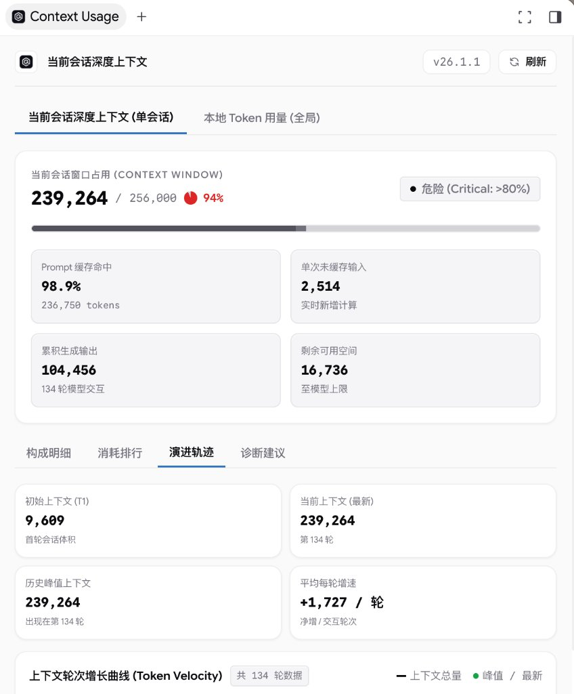
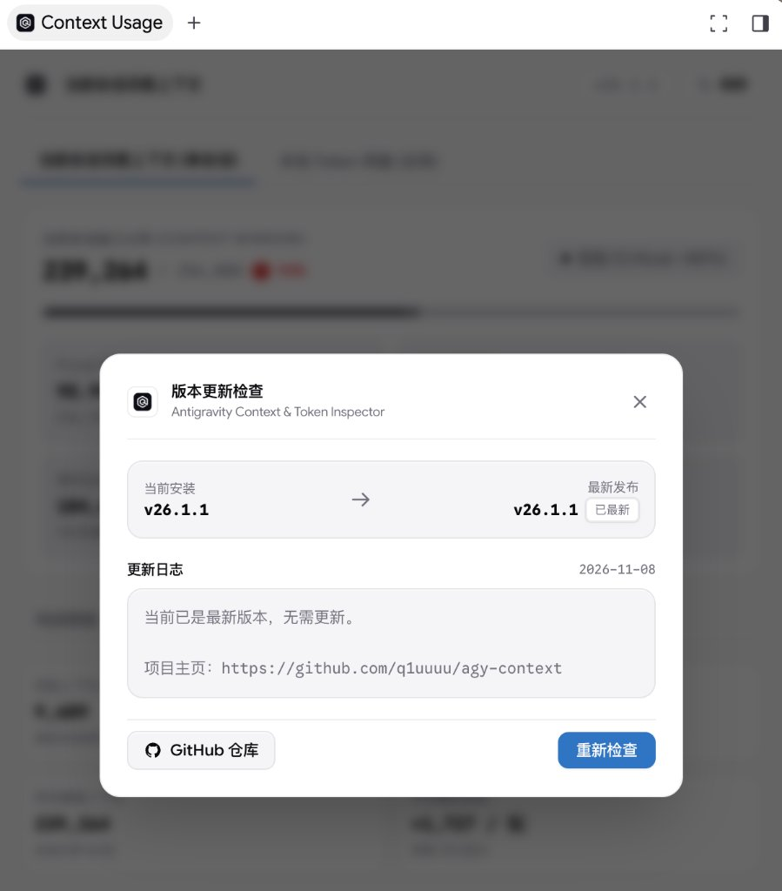

# Antigravity Context & Token Inspector (`agy-context`)

<p align="center">
  <a href="LICENSE"></a>
  <a href="https://github.com/q1uuuu/agy-context/releases"></a>
  <a href="https://github.com/q1uuuu/agy-context"></a>
  <a href="https://github.com/q1uuuu/agy-context"></a>
</p>

高性能本地 Token 用量与上下文深度监控插件，专为 **Google Antigravity** 平台量身打造。

原生嵌入 Antigravity 右侧辅助侧边栏（Auxiliary Pane），基于后台静默 Sidecar 守护进程常驻运行，提供当前会话深度上下文诊断、本地全局用量大盘分析以及在线一键无感升级。

---

> ###  English Overview
> **Antigravity Context & Token Inspector** (`agy-context`) is an ultra-fast, zero-dependency extension embedded in Google Antigravity's Auxiliary Pane. It provides real-time single-session context breakdown, prompt cache ratio diagnostics, heavyweight consumer rankings, velocity growth curves, and aggregated local token usage histograms with dynamic multi-model pricing estimation. Built with Antigravity 2.0 industrial minimalism.

---

##  界面实机预览 (Screenshots)

<p align="center">
  
  
</p>

<p align="center">
  <em>左图：当前会话深度上下文（窗口占用、Prompt 缓存率、演进轨迹曲线） | 右图：在线检查更新与一键无感升级弹窗</em>
</p>

---

##  核心特性 (Key Features)

### 1. 当前会话深度上下文 (单会话视图 - 默认主界面)
* **会话窗口实时占用 (Context Window Gauge)**：
  - 动态显示当前已占用 Tokens、模型上限阈值与实时占比百分比。
  - 健康状态动态评估（良好 / 警告 >60% / 危险 >80%），并在超载时主动推荐 `/compact` 剪枝策略。
* **原生单色分项堆叠条 (Segmented Stacked Bar)**：
  - 精准剖析四维构成：系统提示词与规则、工具 I/O 与文件读写、用户输入、模型历史与深度思考（Thinking）。
* **四大深度子面板**：
  - **构成明细**：分项 Token 绝对值与占比统计，集成工具调用频次与体积分布列表。
  - **消耗排行 (Top 10 Heavyweight Eaters)**：抓取会话中单次消耗最大的巨型输入项（如大型代码文件、冗长命令执行输出），精准定位膨胀源头。
  - **演进轨迹 (Token Velocity)**：SVG 平滑曲线绘制上下文随交互轮次的增长斜率，直观呈现每轮交互的增量冲击，支持悬停十字游标查阅详情。
  - **诊断建议**：根据缓存命中率与工具消耗占比，提供个性化上下文优化指引。

### 2. 本地 Token 用量大盘 (全局视图)
* **多范围灵活筛选**：
  - 支持 **今天 / 昨天 / 近 3 天 / 近 7 天 / 近 30 天** 随心切换。
* **8 项核心指标矩阵**：
  - 范围总 Token (百万级紧凑换算与全额计量)、输入 Token、输出 Token、Prompt 缓存命中率、API 预估费用、首字延迟 (TTFT)、正文速度 (token/s)、平均输入规模。
  - 首字延迟与正文速度基于全局最新 10 次回复滚动采样计算中位数，真实反映当前硬件流式吞吐性能。
* **24 小时直方柱状图与交互悬停看板**：
  - “今天/昨天”自动呈现 24 小时（00:00 ~ 23:00）直方图，X 轴精确定位 3 小时间隔刻度。
  - “近 3/7/30 天”自动切换为按日统计柱状图。
  - 鼠标悬停任意柱子，右上角数据看板实时联动更新，**按真实模型单价精准核算各时间段费用**。
* **多模型份额分布图表与明细**：
  - **Token 用量视图**：按各模型在总消耗中的实际占比等比例呈现进度条。
  - **预估费用视图**：单色 SVG 环形 Donut 图与模型费用占比清单。
  - **最新主流模型覆盖**：同步 OpenRouter 实时费率（Gemini 3.8 Flash, Claude Sonnet 4.6, Claude Opus 4.6, GPT-OSS 120B, Gemini 4 Argon, Claude Sonnet 5.5, Claude Opus 5.5 等），支持用户自定义配置覆盖。

### 3. 原生 Antigravity 工业美学设计
* **象牙白与黑灰极简调色板**：适配 Antigravity 原生象牙白 (`#faf9f5`) 与深色曜石黑 (`#0f0f11`)，拒绝杂乱颜色与表情符号。
* **浮动岛屿（Island）布局**：外层容器保留舒适呼吸边距，各功能块以圆角悬浮卡片（`rounded-xl`）呈现，绝不紧贴窗口边框。
* **专属六边形品牌标识**：搭载 q1u 专属黑白灰极简工业风几何 Logo。
* **零侵入架构**：通过 Antigravity 官方 Sidecar 守护进程规范管理生命周期，无需手动轮询，启动即用。

### 4. 检查更新与一键无感升级
* **全自动在线版本感知**：静默与 GitHub Releases 对齐，当发现新版本时在顶栏低调浮现呼吸徽章。
* **一键无缝热重载**：内置专属更新弹窗，支持查阅版本更新日志（Release Notes），点击「立即更新」全自动完成跨平台下载、解压、备份、原子覆写与后台服务热重启，零繁琐手动替换。

---

##  安装与分发 (Quick Start)

### 方式一：一键自动安装 (推荐)

克隆或解压本扩展包至本地后，直接执行配套安装脚本：

#### Windows (PowerShell):
```powershell
.\install.ps1
```

#### macOS / Linux (Terminal):
```bash
chmod +x install.sh && ./install.sh
```

安装脚本会自动将扩展放置到 Antigravity 全局插件目录并自动热激活 Sidecar 服务。

---

##  唤出与使用

在 Antigravity 中有便捷方式唤出看板：
1. **侧边栏原生直达**：点击 Antigravity 右上角 `...` 菜单 -> **`Extensions >`** -> 选择 **`Context Usage`**，即可在右侧 Auxiliary Pane 原生展开。
2. **对话内一键展开**：在任何会话中点击链接直接打开：  
   `[⚡ 打开上下文监控看板](sidecar://agy-context/context-panel/)`
3. **全局常驻守护**：后台 Sidecar 守护进程随 Antigravity 静默运行，实时自动跟踪模型交互与 Token 变动，无需手动触发。

---

##  一键干净卸载

如需彻底移除扩展，在解压目录运行：
* **Windows**：`.\uninstall.ps1`
* **macOS / Linux**：`./uninstall.sh`

脚本将自动安全注销 Sidecar 进程，并彻底清理所有配置文件，绝不残留多余的菜单项与后台孤儿进程。

---

##  License & Credits

* **Author**: [q1u](https://github.com/q1uuuu)
* **Repository**: [https://github.com/q1uuuu/agy-context](https://github.com/q1uuuu/agy-context)
* **Platform**: Google Antigravity
* **License**: [Apache License 2.0](LICENSE) - Copyright (c) 2026 q1u
