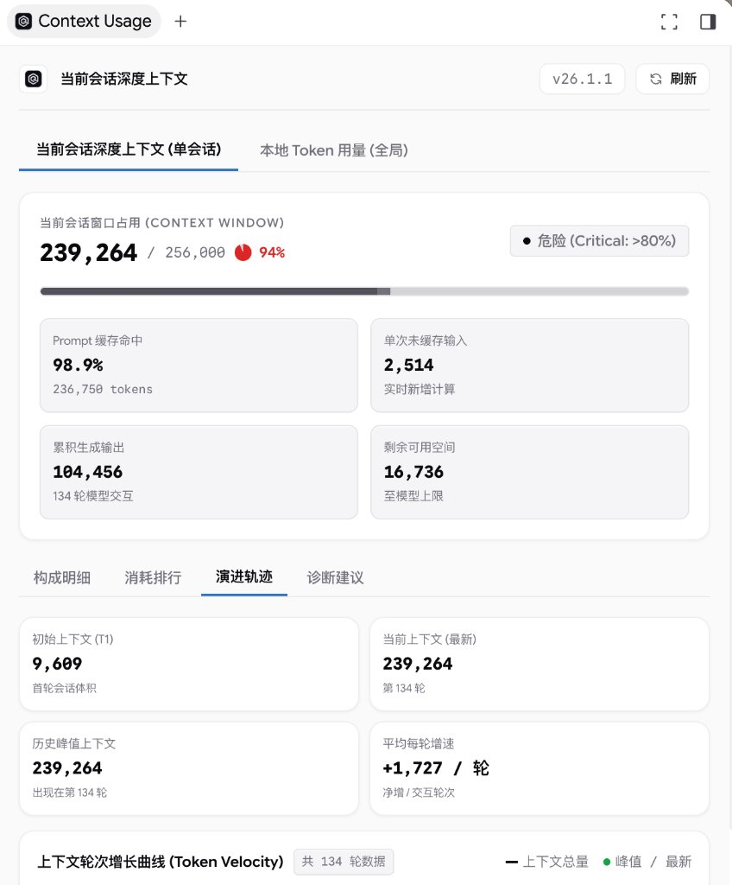
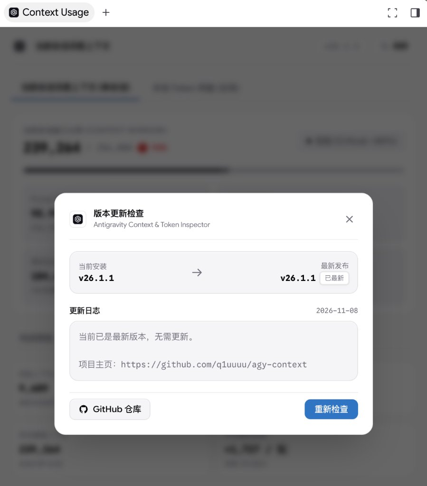

# Antigravity Context & Token Inspector (`agy-context`)

<p align="center">
  <a href="LICENSE"></a>
  <a href="https://github.com/q1uuuu/agy-context/releases"></a>
  <a href="https://github.com/q1uuuu/agy-context"></a>
  <a href="https://github.com/q1uuuu/agy-context"></a>
</p>

专为 **Google Antigravity** 打造的高性能上下文诊断、Token 用量分析、多账号额度切换与上下文窗口解锁插件。

原生嵌入 Antigravity 右侧辅助侧边栏（Auxiliary Pane），通过后台 Sidecar 守护进程常驻运行，零全局提示词开销，提供单会话上下文实时透视与模型切换/缓存诊断、上下文 `256K` 隐式上限解锁、多账号 `5H / WEEK` 双窗口额度监控与加密凭据一键切换、支持自定义日历区间的本地全局 Token 账单大盘分析以及一键无感热升级。

---

> ### English Overview
> **Antigravity Context & Token Inspector** (`agy-context`) is a lightweight, zero-prompt-overhead extension embedded in Google Antigravity's Auxiliary Pane. It combines real-time single-session context diagnostics (official Language Server telemetry with cached transcript fallback, compact streaming TTFT/throughput metrics, and compaction/model-switch/cache-miss aware timelines), live multi-account dual-window quota monitoring (`5H` / `WEEK`) with encrypted OS credential snapshot switching and one-click app restart, an inline cross-platform Context Window Unlocker (`256K` / `512K` / `900K` presets via `.gopclntab` symbol resolution), incremental disk-indexed local token & cost analytics with a custom calendar range picker and OpenRouter-synced model pricing, and one-click OTA updates—styled in Antigravity 2.0 Onyx monochrome minimalism.

---

## 界面实机预览 (Screenshots)

<p align="center">
  
  
</p>

<p align="center">
  <em>左图：会话上下文（窗口占用、构成明细与演进轨迹） | 右图：在线检查更新与一键无感热升级浮层</em>
</p>

---

## 核心特性 (Key Features)

### 1. 会话上下文（单会话视图 - 默认主界面）
* **实时窗口占用与环形进度指示**：
  - 优先通过 Language Server RPC（`StreamAgentStateUpdates`）获取官方精确上下文计数，并在不可用时自动平滑回退至本地 Transcript 估算（内置文件签名缓存，显著降低轮询开销）。
  - 配备高对比度 SVG 环形占用率指示器与健康阈值预警（`>60%` 警告 / `>80%` 危险），过载时建议执行 `/compact` 压缩上下文。
* **分项构成堆叠条 (Segmented Stacked Bar)**：
  - 官方遥测模式下精确呈现三维分布：**系统提示词 (System Prompt)**、**工具与上下文注入 (Tools)**、**对话消息 (Chat Messages)**；本地回退模式下提供四维分布（系统规则 / 工具 I/O / 用户输入 / 模型历史与思考）。
* **单会话流式性能条**：
  - 在概览卡片底部以紧凑自适应条形式展示当前会话的 **正文速度 (tok/s)**、**总速 (tok/s)**、**首字延迟 (s)** 与 **累计耗时**，悬停 `(i)` 图标可查看中位数、最新值与有效采样轮次详情。
* **三大深度子面板**：
  - **演进轨迹 (Timeline & Compactions - 默认首屏)**：SVG 平滑曲线展示会话轮次的上下文增长斜率，自动高亮 **峰值焦点 (Peak)**、**上下文压缩/裁剪节点**（`CHECKPOINT`、`SYSTEM_MESSAGE`、`TOKEN_DROP`）以及 **模型切换点（切模型虚线标记与 Plan / Exec 阶段标识）**；支持二维悬停精确定位，并在悬浮卡片内提供 **同模型轮次间隔** 与 **0 缓存智能诊断**（区分模型切换不复用、间隔过长过期与短间隔异常击穿）。
  - **构成明细**：各维度 Token 绝对值、百分比占比进度条，以及内置工具调用频次分布统计。
  - **上下文解锁**：内联展示桌面端 Language Server / `agy` CLI 检测状态、三道门禁状态、目标上下文档位配置与执行日志，支持一键解锁与还原备份。

### 2. 多账号额度监控与加密快照切换 (Account Quota & Fast Switch)
* **顶栏实时双窗口额度胶囊**：
  - 顶栏右侧常驻展示当前账号标识（优先显示自定义别名或邮箱前缀）、健康状态点以及 **`5H`** 与 **`WEEK`** 双窗口最低余量百分比（超窄侧边栏自动精简显示）；悬停或点击即可平滑展开账号管理浮层。
  - 支持手动即时刷新、后台定时同步、单会话轮次完成后自动触发刷新，以及重置时间到期后自动重新校准。
* **官方双分组额度透视**：
  - 通过 Language Server Connect-RPC 并行请求 `GetUserStatus` 与 `RetrieveUserQuotaSummary`，按 **Gemini Models** 与 **Claude & GPT** 两大官方模型组分别展示 **5H（短期窗口）** 与 **WEEK（周额度窗口）** 进度条及重置倒计时（若周额度接口暂缺则回退显示本地近 7 天 Token 用量参考）。
* **跨平台零外部依赖加密凭据库**：
  - 自动发现并捕获官方已登录账号的操作系统凭据（Windows 凭据管理器 `CredReadW` / `CredWriteW`、macOS 钥匙串 `security`、Linux `secret-tool`），加密存储于 `~/.gemini/antigravity/plugin_data/agy-context/accounts.vault.json`。
  - Windows 默认使用绑定当前系统用户的 **DPAPI (`win-dpapi-v1`)** 加密；macOS / Linux 及回退场景使用 **AES-256-GCM (`aes-256-gcm-v1`)** 配合仅当前用户可读（`0600`）的本地 `.vault.key` 加密。
  - 全链路内置并发写锁、原子文件落盘、重复凭据哈希冲突拦截与待重启防覆盖保护，防止多账号快照互相污染。
* **切出快照管理与一键重启客户端**：
  - 切换账号前自动备份当前账号的最新凭据与额度快照，支持 **内联编辑账号备注**、**二次确认防误删**，并在非当前账号行展示 **切出余量预估条**（自动根据重置时间推算已恢复的 100% 窗口，并遵循周额度耗尽约束；悬停可查看双组明细与快照时间）。
  - 凭据写入完成后提供跨平台 **一键重启 Antigravity 客户端**（Windows 通过 WMI `Win32_Process` 脱离进程组确保重启器稳定拉起，macOS / Linux 独立守护重启）。

### 3. 上下文窗口解锁与预设管理 (Context Unlock & Presets)
* **突破官方 256K 隐式上限**：
  - 自动发现本地 Antigravity Desktop Language Server（`language_server` / `language_server.exe`）与 `agy` CLI（`agy` / `agy.exe`），跨平台支持 macOS / Linux / Windows（Mach-O / ELF / PE，arm64 & x86-64），并内置路径、版本与门禁检测缓存加速面板加载。
* **`.gopclntab` 动态符号定位**：
  - 通过内置 [`scripts/agy-patch.py`](scripts/agy-patch.py) 动态解析 Go 二进制符号表，定位并打通三道限制门：
    - **Gate 1 (`model.SelectorModel.offersContextWindow`)**：为模型选择器开放上下文选项；
    - **Gate 2 (`store.(*Store).ContextWindow`)**：解除模型白名单与实验开关门控；
    - **Gate 3A / 3B**：移除 `256,000` (`0x3e800`) 检查点上限夹紧并清除实验覆盖硬限，恢复完整物理上下文预算（同时可选恢复 `AGY_CLI_AUTO_COMPACT_OVERRIDE` 环境变量支持）。
* **预设档位与版本绑定备份**：
  - 提供 **`256K`**（基准 1.0x）、**`512K`**（默认均衡扩展，~1.3x）、**`900K`**（深度分析，~1.8x）三档预设并同步写入 `agy` CLI 配置。
  - 「上下文解锁」子 Tab 栏实时反馈解锁状态点（未解锁呈灰色、解锁后呈绿色）并附带当前预设徽标。
  - 执行修补前自动校验 SHA-256 并将原始二进制版本绑定备份至 `~/.gemini/antigravity/plugin_data/agy-context/`（同步持久化 `context-settings.json`），支持在内联面板中随时 **一键还原备份**（还原成功后自动重置预设为 `256K`）。

### 4. 本地全局用量大盘 (本地全局用量)
* **灵活时间范围与 Onyx 自定义日历选择器**：
  - 顶栏支持 **今天 / 近 7 天 / 近 30 天 / 自定义** 快速切换；点击「自定义」展开单流式日历浮层，支持键盘方向键/翻页导航、跨月浏览、悬停区间预览，并内置 **昨天 / 近 3 天 / 近 14 天 / 本月** 快捷预设。
* **8 项核心指标矩阵**：
  - 采用容器查询自适应 2↔4 列布局，汇总展示 **总用量**、**输入**、**输出**、**缓存命中率**、**API 费用估算**、**首字延迟**、**正文速度** 与 **平均输入**，悬停 `(i)` 图标即可查看精确 Token 数与采样明细。
* **本地生成记录汇总直方图**：
  - 单日范围（如「今天」或自定义单日）展示 24 小时分时柱状图；跨多日范围按日展示，并在超长跨度下智能聚合为 **按周汇总** 或 **按月汇总**；
  - 鼠标悬停或点击任意柱体，右上角汇总看板实时联动更新对应时段的 Token、输入/输出/缓存明细、请求次数与按真实模型单价核算的预估费用。
* **增量磁盘索引与异步扫描引擎**：
  - 采用异步非阻塞扫描与持久化磁盘索引（`~/.gemini/antigravity/plugin_data/agy-context/token-index.v1.json`），按数据库文件签名与步进增量解析，配合价格配置 mtime 缓存及 Windows PowerShell 原生扫描大 Payload 跳过优化，大幅缩短历史账单加载耗时。
* **模型分布与明细**：
  - **Token 用量视图**：按模型（含不同思考强度档位）占比呈现进度条。
  - **预估费用视图**：交互式 Onyx 单色分段 SVG 环形 Donut 图，支持悬停高亮对应模型份额与费用明细。
  - **主流模型覆盖与自定义费率**：内置对齐 OpenRouter 费率的最新模型配置（包括 `Gemini 4 Neon`、`Gemini 4 Carbon`、`Gemini 4 Argon`、`Gemini 4 Hydrogen`、`Gemini 3.8 / 3.7 / 3.6 Flash`、`Gemini 3.1 Pro`、`Nano Banana 2 / 2.1`、`Claude Sonnet 4.6 / 5.5`、`Claude Opus 4.6 / 5.5`、`GPT-OSS 120B` 等），支持本地 JSON 单价覆盖。

### 5. Antigravity 2.0 Onyx 工业设计 & 在线无感升级
* **Onyx 极简双主题与窄屏自适应**：自适应 Antigravity 深色（`#0D0D11` / `#15151A`）与浅色（`#FAFAFA` / `#FFFFFF`）调色板，采用圆角悬浮卡片、低对比度骨架屏加载、超窄侧边栏紧凑排版与统一互斥下拉浮层（版本更新 / 账号切换 / 自定义日历）。
* **零侵入安全架构**：原生插件内置 Sidecar 守护进程，不向全局安装任何提示词规则文件；严格校验本地 Origin CORS 与请求体大小限制；后台标签页隐藏时自动暂停轮询以降低空闲开销；优先使用 Antigravity 内置 Node `node:sqlite` 或系统 `sqlite3` 读取本地会话数据库及归档库（Windows 支持 `winsqlite3.dll` 与 PowerShell 原生回退）。
* **在线检查更新与热重启**：静默对比 GitHub Releases，发现新版本后顶栏浮现更新徽章，可在顶栏版本浮层中查阅 Release Notes 并一键完成跨平台下载、解压、覆盖与多协议/多端口自适应 Sidecar 热重载。

---

## 运行环境与依赖 (Requirements)

* **宿主机环境**：Google Antigravity
* **Node.js**：`>= 18.0`（桌面端插件运行时优先使用 Antigravity 内置 `node:sqlite`；独立运行或老版本环境可选系统 `sqlite3`）
* **Python 3**（可选）：仅在需要使用「上下文窗口解锁」功能对二进制执行本地修补时要求本机已安装 `python3` / `python`
* **Linux `secret-tool`**（可选）：仅在 Linux 桌面环境使用「多账号加密快照切换」读写系统密钥环时需要安装 `libsecret-tools`（Windows 与 macOS 均使用系统内置 API，无需额外依赖）

---

## 安装与分发 (Quick Start)

克隆或下载解压本仓库后，在项目根目录执行对应平台的安装脚本：

### Windows (PowerShell)
```powershell
.\install.ps1
```

### macOS / Linux (Terminal)
```bash
chmod +x install.sh && ./install.sh
```

安装脚本会自动完成以下工作：
1. 环境预检（Antigravity 本地存储目录及 SQLite 读取能力检测）。
2. 将插件安装至全局插件目录（`~/.gemini/config/plugins/agy-context`，Windows 为 `%USERPROFILE%\.gemini\config\plugins\agy-context`），并清理旧版遗留目录与冗余文件。
3. 在 `~/.gemini/config/config.json` 中注册并启用 `"agy-context"`，同时尝试通过 Language Server RPC 自动热激活 Sidecar。

---

## 唤出与使用

在 Antigravity 中可通过以下方式打开看板：
1. **侧边栏原生直达**：点击 Antigravity 右上角 `...` 菜单 -> **`Extensions >`** -> 选择 **`Context Usage`**，即可在右侧 Auxiliary Pane 原生展开。
2. **对话内直达链接**：在任意会话中点击或发送：  
   `[⚡ 打开上下文监控看板](sidecar://agy-context/context-panel/)`
3. **后台静默守护**：Sidecar 随 Antigravity 自动启动与保活，实时同步当前活跃会话、账号额度状态与本地用量记录。

---

## 自定义模型单价 (可选)

如需覆盖内置的 OpenRouter 参考单价或新增私有模型费率，可创建或编辑 `~/.gemini/antigravity/pricing_config.json`（单位：USD / 1M tokens）：

```json
{
  "rates": {
    "gemini-4-neon": { "input": 3.00, "output": 15.00, "cached": 0.15 },
    "my-custom-model": { "input": 1.00, "output": 5.00, "cached": 0.10 }
  }
}
```

---

## 一键干净卸载

如需完整移除插件，请在项目或插件目录执行卸载脚本（如曾使用过「上下文窗口解锁」，建议卸载前先在 **「上下文解锁」** 子面板中点击 **「还原备份」** 恢复官方原始二进制）：

* **Windows**：`.\uninstall.ps1`
* **macOS / Linux**：`./uninstall.sh`

卸载脚本会自动通知 Language Server 停用并注销 `agy-context/context-panel` Sidecar，清理插件与遗留数据目录，并移除 `~/.gemini/config/config.json` 中的注册项。

---

## License & Credits

* **Author**: [q1u](https://github.com/q1uuuu)
* **Repository**: [https://github.com/q1uuuu/agy-context](https://github.com/q1uuuu/agy-context)
* **Platform**: Google Antigravity
* **License**: [Apache License 2.0](LICENSE) - Copyright (c) 2026 q1u

---

## 致谢与交流
* **[Linuxdo](https://linux.do)**
